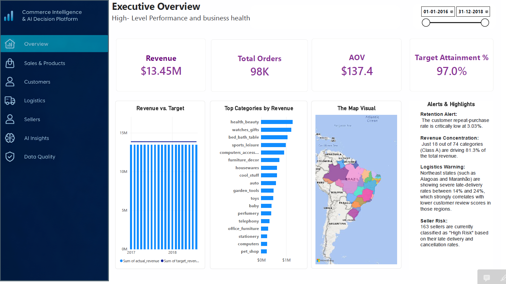
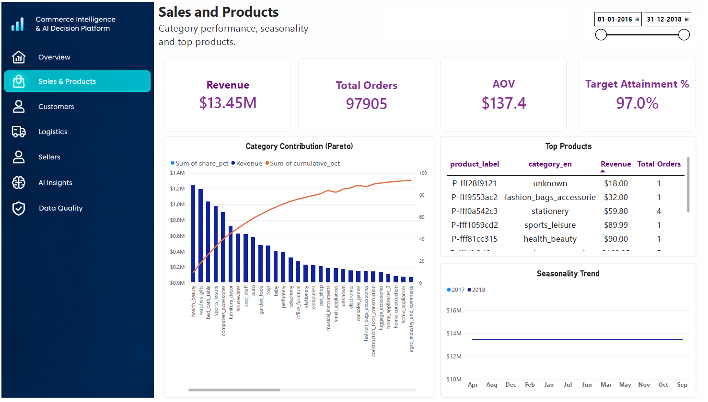
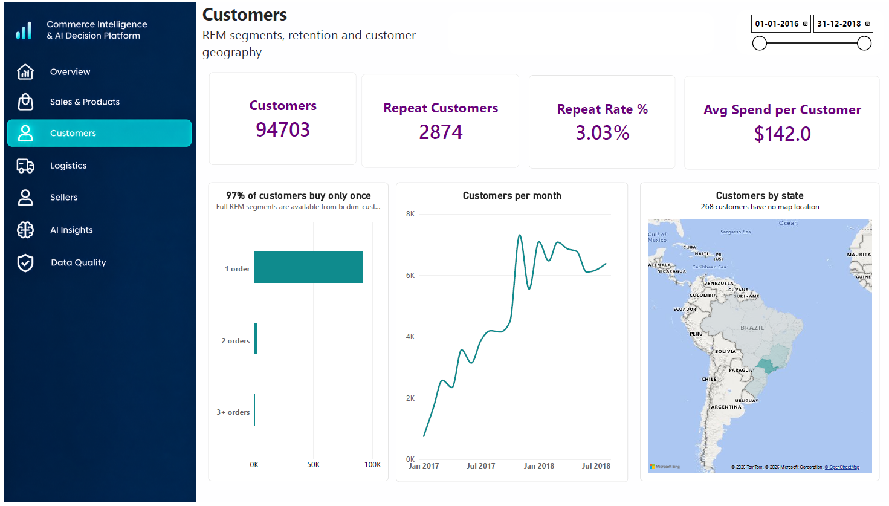
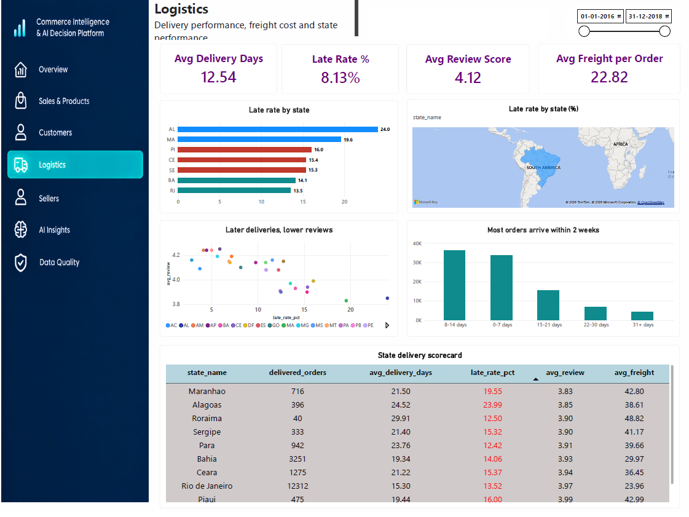
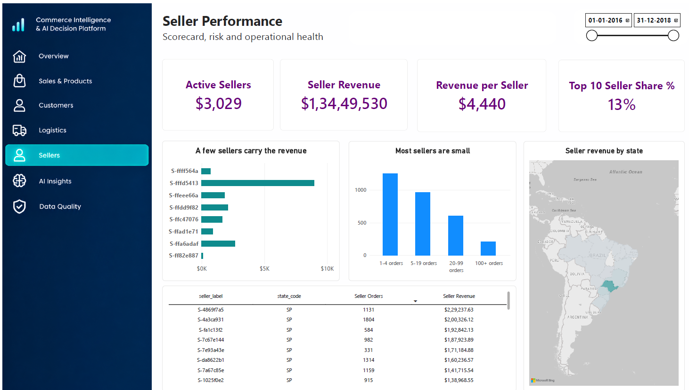
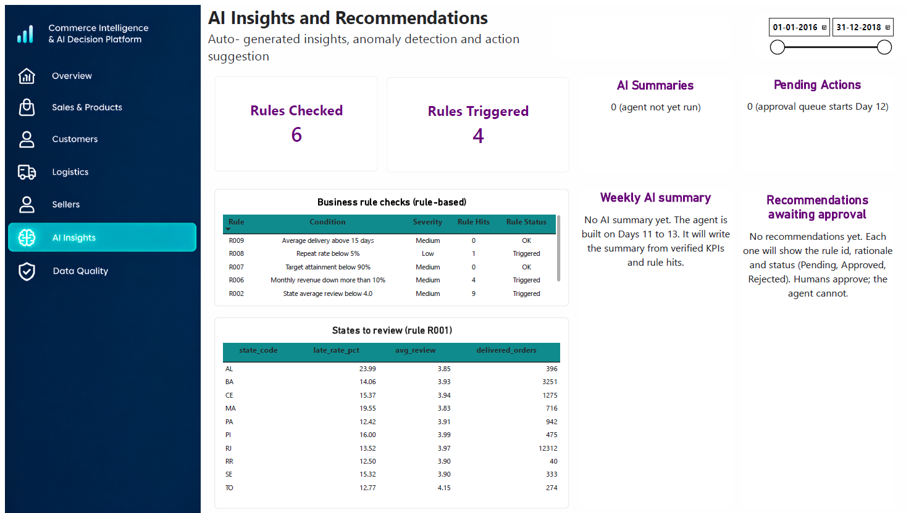
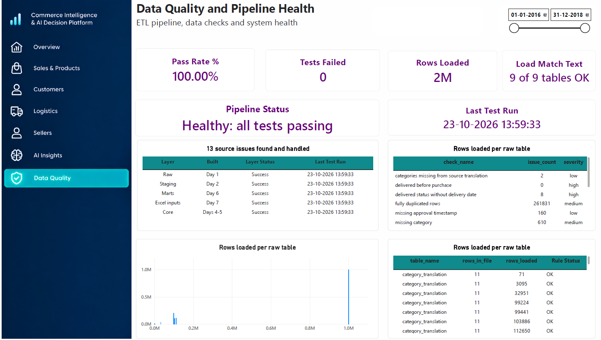

# Olist Commerce Intelligence & AI Decision Platform
End-to-end analytics project: PostgreSQL warehouse, Power BI report and a guarded AI agent,
built on the public Olist Brazilian E-Commerce dataset (2016-2018, BRL).
Portfolio project; not a deployed company system.
## Progress- [x] Day 1: environment, raw load with audit log (9 tables, row counts verified)- [x] 
Day 2: staging layer, delivery metrics, 13 data-quality checks- [ ] 
Day 3: automated data-quality tests- [ ] 
Days 4-6: star schema, marts, advanced SQL- [ ]
Day 7: Excel inputs and database security- [ ]
Days 8-10: Power BI model and report- [ ] 
Days 11-13: AI agent (guarded SQL, investigations, evaluation)- [ ] 
Days 14-15: chat interface, documentation, demo
## Architecture
raw (exact copy) -> staging (typed, deduplicated) -> core (star schema) -> marts (KPIs)-> Power BI and AI agent
## Run it
1. Install PostgreSQL 18 and Python; create database olist_dw
2. python -m venv .venv ; activate ; pip install -r requirements.txt
3. Copy .env.example to .env and set DATABASE_URL
4. Download the Olist CSVs from Kaggle into data/raw
5. python python/etl/ingest.py
6. python python/etl/run_sql.py sql/03_staging_transformations.sql
## Key decisions- Raw layer stored as text to stay an exact copy of the source- Separate fact grains for items, payments and reviews- Analysis window Jan 2017 to Aug 2018 (other months sparse)

Day 3
## Limitations
Historical data, BRL, no costs or targets, anonymised sellers and products
Tick Day 3 in the progress list and add a short Testing section:
- [x] Day 3: 52 automated data-quality tests, results stored in audit.test_results
## Testing
pytest tests -q # run the 52 data-quality tests
python python/etl/validate.py # run and store results in audit.test_results
Policy: docs/data_quality_policy.md
Homework

- [x] Day 4: star schema dimensions (6 tables) and 39 tests (91 total)
Day 5: fact tables
We build fact_order_items (one row per item, with price and freight), fact_orders (one row per order, with delivery
measures), fact_payments and fact_reviews. Each fact stores dimension keys: customer_key, product_key,
seller_key, geography_key and date keys for purchase, delivery and estimated dates (the role-playing date
dimension). Missing matches use key -1. The central test is that revenue, freight, payments and review counts in the
facts equal staging, so the star schema reproduces the same numbers. Remember the fan-out rule: facts stay
separate, and measures are never summed after joining items to payments.

- [x] Day 5: fact tables (4) and 58 tests (149 total); revenue reconciles to staging
Day 6: marts and advanced SQL
Marts are ready-made business tables and views for Power BI and the AI agent. We build: monthly revenue with
month-over-month growth and 3-month moving average; Pareto (80/20) analysis by category; delivery performance
by state; customer RFM segmentation with NTILE; cohort retention by first-purchase month; and a seller risk score
from late deliveries, reviews and cancellations. We add indexes and compare query plans with EXPLAIN ANALYZE,
and write kpi_definitions.md so every KPI has one definition used in SQL, DAX and the AI agent. Expect the
repeat-purchase rate to stay around 3 percent, which is a business finding to report honestly.

• Commit and push Day 3 (git add, git status, git commit, git push).
• Do the break-it experiment and capture screenshot 07.
• Answer five interview questions aloud.
Day 4 preview: dimension tables
We start the star schema in the core schema: dim_date (one row per calendar day with year, month, week and
weekend flags), dim_customers, dim_products, dim_sellers and dim_geography. Each gets a surrogate key, a
primary key and its own tests. These dimensions are what Power BI will filter and slice by.

- [x] Day 6: 8 marts (growth, Pareto, RFM, cohorts, seller risk), KPI definitions, 45 tests (194 total)
Day 7: Excel business inputs and database security
Excel becomes a controlled business input. We create three workbooks: sales_targets.xlsx (illustrative monthly

## Power BI report

Full report: [olist_report.pdf](powerbi/olist_report.pdf)

Portfolio project on public Olist data (2016 to 2018, BRL). Targets are illustrative. The .pbix is not published because of the dataset's non-commercial licence.
targets, labelled as such), business_rules.xlsx (rule id, metric, operator, threshold, severity, recommended action,
active) and data_dictionary.xlsx. A Python loader validates each file (column names, types, uniqueness, allowed
operators, no negative targets) before loading into reference tables with an audit record, and a new mart compares
actual revenue with target. The seller risk tiers and delivery thresholds move into business_rules. We also create
database roles: bi_ro for Power BI, agent_ro (read-only on marts only, with a statement timeout) and agent_rw
(insert only into the agent tables), and write tests proving the agent role cannot read raw data or change anything.
